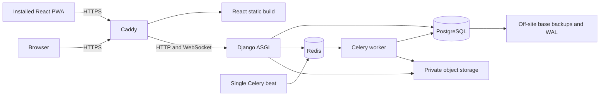

# Coast TT — deployment and operating runbook

Updated 2026-09-08. Requirements: [spec.md](spec.md#req-034). Tasks: [tasks.md](tasks.md). Acceptance: [EVAL-034](test.md#eval-034), [EVAL-035](test.md#eval-035).

## Status and assumptions

No server, DNS record, mobile build, image registry, database or paid subscription has been provisioned. The container artifacts exist (2026-11-20, TASK-058 in progress) and were tried locally with `APP_DOMAIN=localhost`: `services/api/Dockerfile.production` (API, worker and beat), `apps/web/Dockerfile.production` (Caddy with the PWA build and Django's static files), `infra/Caddyfile`, `infra/compose.production.yml` and the secret-free `infra/production.env.example`. Still to do for TASK-058: publish images from CI to a chosen registry, object storage for attachments and backups, and the staging deploy and rollback rehearsal on a VPS. Do not run production examples against an arbitrary existing server.

Launch runs the React PWA/Django core without streaming, video workers, subscription billing or a native app. PostgreSQL is the durable source of truth; Redis is private transport/cache, not the only copy of queued work. The PWA build, manifest and service worker are hosted over HTTPS. React Native/Expo and store distribution are a deferred follow-on.

## Hosting decision

| Option | Supported topology | Position |
|---|---|---|
| Contabo VPS | Full Docker Compose deployment | Default reference target |
| Namecheap VPS with root access | Same Compose services | Supported alternative |
| Namecheap shared hosting + VPS | React static files on cPanel; API/ASGI, jobs, DB and Redis on VPS | Supported split frontend option |
| Namecheap shared hosting alone | WSGI Python is available, but does not support planned ASGI backend | Not a full-product deployment |

Namecheap explicitly states that ASGI Python applications are not supported on shared plans. Do not silently replace Channels with polling, PostgreSQL with SQLite, or Celery with request-time execution to fit that limit. A WSGI demonstration would be a different scope, not a production deployment of this specification. [Namecheap Python app documentation](https://www.namecheap.com/support/knowledgebase/article.aspx/10048/2182/how-to-work-with-python-app/) (checked 2026-09-07).

Namecheap documents full root access on its VPS, allowing required server software to be installed. Contabo documents unmanaged access and operator responsibility for server configuration. Account management tier and purchased OS still need verification before provisioning. [Namecheap VPS control](https://www.namecheap.com/support/knowledgebase/article.aspx/509/48/what-level-of-control-do-i-receive-with-my-vps-package/), [Contabo server security](https://help.contabo.com/en/support/solutions/articles/103000347171-how-can-i-improve-the-security-of-my-server-) (checked 2026-09-07).

### Initial sizing and provider selection

- Reference baseline: approximately 4 vCPU, 8 GB RAM and 80 GB SSD/NVMe on Ubuntu 24.04 LTS. These are planning estimates, not demonstrated capacity or a particular provider SKU.
- Choose region after measuring latency and packet loss from the actual Nairobi/Mombasa mobile networks. Do not assume the geographically nearest region has the best route.
- Keep at least 25% disk headroom; object storage holds attachments/backups and later raw recordings. Do not store tournament video on the database disk.
- Staging may use a smaller separate VPS. If sharing a host temporarily, use isolated Compose projects, credentials, volumes and resource limits; document the shared failure domain.
- Verify current monthly/renewal prices, VAT, setup fees, backup add-ons, location premiums and transfer limits before purchase. No provider purchase is authorized by this file alone.
- Run EVAL-033 before declaring the selected VPS sufficient. Split DB/workers or resize based on actual load; heavy FFmpeg/AI workers are separate in media phases.

## Service topology



Compose services: `proxy`, `api`, `worker`, `beat`, `db`, `redis`. Daphne runs Django ASGI (`--proxy-headers`, so the client address Caddy forwards is used for throttling and logs). The proxy image carries the PWA build and Django's collected static files, so a release replaces both images together; the API image runs as a non-root user. Redis needs a password (`REDIS_PASSWORD`) and keeps nothing on disk, because the outbox in PostgreSQL holds the work. Worker and beat use the same immutable application image/release as API. Define a bounded worker concurrency; one beat instance. Jobs reference database IDs rather than embedding sensitive records in Redis payloads.

Use named volumes for PostgreSQL, necessary Redis persistence, and Caddy certificates. Containers have restart policies and readiness dependencies. Container restart is not data recovery. Only proxy binds public HTTP/HTTPS. DB and Redis bind no host-public ports. Do not mount the Docker socket into application containers.

For split frontend hosting, PWA HTML, manifest, service worker and assets come from Namecheap; HTTPS API/WebSockets go to the VPS. Caddy still serves backend static assets and API TLS. The service worker controls only its frontend origin/scope, not the API domain. Future native clients can use the same API domain.

## Domains and configuration contract

Use a domain owned by the operator. Examples below use reserved `example.com` names, not actual purchased names:

| Name | Destination |
|---|---|
| `app.example.com` | React web host (VPS by default; shared host in split option) |
| `api.example.com` | VPS API and `/ws/` |
| `staging-app.example.com` | Staging frontend |
| `staging-api.example.com` | Staging API |

DNS: set A records to the selected hosts; publish AAAA only if IPv6/firewall/listener are configured. Begin with low TTL during cutover, raise after validation. Domain registration/DNS at Namecheap does not require Namecheap application hosting. Prefer frontend/API under the same registrable domain to simplify secure browser sessions.

Document a deployment-specific environment file outside source control and readable only by the deployment account. CI holds registry/deployment secrets through its secret store. Public client variables must contain only non-secret identifiers/URLs.

| Configuration | Scope and rule |
|---|---|
| `DJANGO_SECRET_KEY` | Server only; unique per environment |
| `DJANGO_DEBUG` | False outside local development |
| `DJANGO_ALLOWED_HOSTS` | Exact API domains, no production wildcard |
| `DJANGO_CSRF_TRUSTED_ORIGINS` | Exact HTTPS browser origins allowed besides the API's own: CSRF, state-changing API requests (another site's POST, PUT, PATCH or DELETE gets 403 `origin_not_allowed`) and WebSockets check this list (`core/security.py`). With `DJANGO_DEBUG` off the API refuses to start with a wildcard or non-https origin, or a wildcard host in `DJANGO_ALLOWED_HOSTS`. The API sends no CORS headers: the PWA shares its origin |
| `CORS_ALLOWED_ORIGINS` | Exact web origins; credential support restricted to them |
| `DATABASE_URL` | Server-only private PostgreSQL address/credential |
| `REDIS_URL` | Server-only private Redis address/credential |
| `APP_DOMAIN` | The site's hostname. Caddy serves the PWA and proxies `/api/` (WebSockets included), `/admin/` and `/health/` on it, so the app and API share one origin. `DJANGO_ALLOWED_HOSTS`, `DJANGO_CSRF_TRUSTED_ORIGINS` and `FRONTEND_URL` default to it in `infra/compose.production.yml` |
| `API_DOMAIN` | Not implemented yet: a separate API hostname (the split frontend option) also needs CORS with credentials, which the API doesn't have |
| `POSTGRES_PASSWORD`, `REDIS_PASSWORD` | Server only; compose builds `DATABASE_URL` and `REDIS_URL` from them |
| `HTTP_PORT`, `HTTPS_PORT`, `COMPOSE_PROJECT_NAME`, `WORKER_CONCURRENCY` | Host ports (80 and 443), the project name (separate for staging on a shared host) and worker concurrency (default 2) |
| `SMTP_HOST`, `SMTP_PORT`, SMTP credentials | Transactional account/recovery email; configure SPF/DKIM/DMARC |
| Object storage endpoint/bucket/credentials | Private attachments, separate backup credentials/bucket |
| `ATTACHMENTS_ROOT` | Private attachment folder while the `attachments` storage is the local filesystem; a persistent volume outside the web root, never served by the proxy. Replaced by the object storage settings above once TASK-058 switches the backend |
| Reverse proxy request body limit | Cap request bodies at 6 MB (uploads are limited to 5 MB). The API refuses a larger declared body before reading it, but only the proxy stops one being sent |
| `ATTACHMENT_URL_TTL` | Seconds a signed attachment link stays valid (default 300). Keep it short: a link works without a session until it expires |
| Push provider credentials | Server only; environment-specific |
| `VITE_API_BASE_URL` | Build time, public: the API base the web app calls. Leave unset (`/api/v1`) when Caddy serves the app and API on one origin; set the full HTTPS URL (e.g. `https://api.example.com/api/v1`) for split hosting. Staging builds point at the staging API, production at production. Never put server tokens here; Expo public URL added only with later native app |
| `APP_BUILD` | Build time, public: the web release's number, `YYYYMMDDHHMM` (CI sets it; a local build uses the build time). The service worker version and the `X-Client-Build` header carry it |
| `MIN_CLIENT_BUILD` | Server: the oldest `APP_BUILD` the API still serves (default 0, every build). An older cached app gets 426 `client_outdated` and asks to update; its queued scores stay on the device and the new version sends them. Raise only for a change that breaks older apps, after the new web release is live |
| `WEB_PUSH_PRIVATE_KEY`, `WEB_PUSH_SUBJECT` | Server: browser push (REQ-019, TASK-034). Empty key = push off; the inbox works either way. Make the VAPID key once with `manage.py push_keys` and keep it: a new key stops every subscribed device until its player switches push on again. The subject is a `mailto:` or https contact for push services (default `FRONTEND_URL`). The worker sends push over outbound HTTPS only to the hosts in `WEB_PUSH_HOSTS` (default: Google FCM, Mozilla, Apple, Windows push services) |
| `SECURE_HSTS_SECONDS` | Server: HSTS max-age, 0 (off) by default. Set it (e.g. `31536000`) once every host is checked over HTTPS. Django admin's login is held to `THROTTLE_AUTH_LOGIN` per address, and the live schema (`/api/v1/schema/`) needs a session |
| `TRUSTED_PROXY_COUNT`, `THROTTLE_PUBLIC_READS` | Server: request throttles take the client address from the last `X-Forwarded-For` hop added by this many proxies (default 1, Caddy). Set it to the real number of proxies in front, or a spoofed header can dodge the login and public-page throttles. Signed-out reads of public tournament pages are limited per address (default `120/min`; TASK-035) |
| `SODA_STAKES_ENABLED` | Server: allow soda game stakes (default off). **Leave off in production until the legal and policy sign-off (Kenyan betting and gaming law, age 18+, limits) is recorded in intent.md (TASK-078).** While off, stake fields are refused and hidden, and soda games run without stakes. Clubs can still switch stakes or soda games off for their members |
| `OWNER_EMAIL`, `OWNER_PASSWORD`, `OWNER_NAME` | Server, secret: the platform owner's account. When the API container starts, `manage.py ensure_owner` creates a platform super admin with this email (verified, so they can sign in at once) if none exists, and gives an existing one back its authority if it was lost. The password is used only on creation and must pass the sign-up password rules; later starts never reset it, so the owner changes it after the first login. The owner signs in at `https://APP_DOMAIN/admin` (Django admin, staff only, login attempts rate-limited); the same account also works on the app's own login page. Both empty: no account is made. One set without the other, a weak password or a bad email stops the API from starting. The password is never logged |
| `APP_IMAGE`, `WEB_IMAGE` | Immutable release tag/digest, including previous release in history |
| Later relay/billing secrets | Provision only when those phases are enabled |

The implementation may refine exact variable names, but must update this contract and the checked-in secret-free example together. Enforce HTTPS/secure cookies and CSRF. Trust proxy-forwarded scheme only from the controlled proxy. Begin HSTS after validating all relevant hosts; do not preload prematurely. Sanitize errors and restrict Django Admin to authorized staff with strong authentication.

## Cloudflare in front of the site

Cloudflare is optional. The site works with a plain DNS record pointing at the VPS, and that is the simplest first deployment: keep the record on **DNS only** until HTTPS works, then decide.

When the record is proxied (orange cloud):

- **SSL/TLS mode: Full (strict).** Cloudflare then talks HTTPS to the server and checks its certificate. The server keeps its own certificate: Let's Encrypt (renewal over HTTP keeps working through the proxy) or a Cloudflare Origin CA certificate.
- **Never Flexible.** Cloudflare would fetch the site over plain HTTP, the server redirects HTTP to HTTPS, and the browser loops for ever. It also sends passwords from Cloudflare to the server unencrypted.
- **Plain "Full" works but doesn't check the certificate,** so it protects less than strict for no saving.
- **Error 525** means Cloudflare could not complete HTTPS with the server: nothing listens on port 443, there is no certificate for that name, or the firewall blocks it. Check with `curl -vk --resolve NAME:443:SERVER_IP https://NAME/health/live`.
- **`TRUSTED_PROXY_COUNT` goes up by one** (Cloudflare is one more proxy: 2 with Caddy alone, 3 with Nginx and Caddy). Left as it was, every visitor behind one Cloudflare address shares the login and API rate limits.
- **Close the side door.** With the count raised, a request sent straight to the server's address could fake its own client address. Allow ports 80 and 443 only from [Cloudflare's published ranges](https://www.cloudflare.com/ips/) in the firewall, or turn on Authenticated Origin Pulls.
- **Leave off** Rocket Loader and HTML or API caching rules: the service worker and the API set their own cache headers. WebSockets (live scores) pass through as they are.

## VPS provisioning runbook

1. Confirm provider, purchased resources, region, Ubuntu image, domain control, emergency console access and off-site backup account. Record environment owner and recovery contact.
2. Create a non-root deployment account, install SSH keys and verify a second session before restricting password/root SSH. Keep a tested console recovery path.
3. Apply OS security updates, configure automatic security updates and time synchronization. Schedule reboots outside tournaments.
4. Configure firewall for HTTPS/HTTP and restricted SSH. Verify effective Docker port exposure from another host; firewall settings alone do not prove Docker ports are private.
5. Install Docker Engine and Compose from supported distribution/vendor instructions; record versions. Docker-group access is privileged and limited to deployment operators.
6. Create `/srv/mombasa-tt` with release configuration and restricted environment file; log into the private image registry using a scoped pull credential.
7. Provision private DB/Redis volumes, object buckets, SMTP and push credentials. Configure backups before real member data enters the system.
8. Set DNS, start reverse proxy and obtain HTTPS certificates. Verify certificate chain and WebSocket upgrade end to end.
9. Deploy migrations/static assets and application services using the release procedure below. The owner account is made at start from `OWNER_EMAIL` and `OWNER_PASSWORD` in the environment file (owner decision, 2026-11-26); there is no built-in default password and no demo users in production (`seed_dev` refuses to run with `DJANGO_DEBUG` off).
10. Complete health, auth, tenant-isolation, notification and tournament smoke checks, then record deployment evidence and enable access.

Done: EVAL-034 deployment portion passes and independent monitoring sees healthy public endpoints without exposed private services.

## Release procedure

Build artifacts in CI, not on a memory-constrained production server. CI runs tests, builds PWA/API, checks Django migrations and publishes immutable images tagged by commit. Record PWA bundle, service-worker and IndexedDB schema versions together. Source repository location/provider is not yet chosen; scripts must not depend on unapproved public access.

Planned file: `infra/compose.production.yml`. The following is the intended command interface after TASK-058 creates that file and its dependencies. Commands are examples for a prepared host, not setup scripts supplied in this documentation-only change.

```bash
cd /srv/mombasa-tt
docker compose --env-file .env.production -f infra/compose.production.yml pull --ignore-buildable
docker compose --env-file .env.production -f infra/compose.production.yml run --rm api python manage.py check --deploy
docker compose --env-file .env.production -f infra/compose.production.yml run --rm api python manage.py migrate --plan
```

Before schema changes, confirm a recent restorable backup and inspect the migration plan. Use expand/contract migrations: add compatible fields first, deploy clients/backfills, remove old fields only after supported cached PWA bundles no longer depend on them. Later native clients extend this compatibility window. A long table lock requires a maintenance window and rehearsal on comparable data.

Pause dispatch and drain active worker tasks for deployments that could interrupt writes. Prefer a window with no active tournament. This initial single-VPS topology does not promise zero downtime; scheduled brief interruption must be communicated. Stop old beat before starting the new version. Drain/replace old workers before exposing incompatible new jobs.

```bash
docker compose --env-file .env.production -f infra/compose.production.yml run --rm api python manage.py migrate --noinput
docker compose --env-file .env.production -f infra/compose.production.yml up -d
docker compose --env-file .env.production -f infra/compose.production.yml ps
```

Static files are collected when the API image is built and copied into the proxy image, so there is no collectstatic step on the server. `check --deploy` warns about HSTS (deferred until every host is checked) and `SECURE_SSL_REDIRECT` (Caddy redirects HTTP to HTTPS). The worker gets a 60-second grace period on stop; Celery's warm shutdown lets running tasks finish, and the outbox retries any it couldn't. Health checks: `/health/live` checks process responsiveness; `/health/ready` checks required DB/broker readiness without exposing credentials. Outbox recovery covers broker interruption. The `worker` service runs Celery (`celery -A config worker`) and exactly one `beat` (`celery -A config beat`). A job written to the PostgreSQL outbox wakes a worker once its transaction commits, and beat asks for a sweep every 5 seconds, which picks up retries that are due and any wake-up Redis lost; tasks are acknowledged late, so one a dying worker held goes to another, and the outbox row lock makes the repeat harmless. No job is run inside a web request. Without `REDIS_URL` (local development only) `python manage.py work_outbox` polls the outbox instead. `/health/ready` checks Redis whenever `REDIS_URL` is set. Live updates: `/api/v1/ws/tournaments/{id}/` (Daphne, Channels with the Redis channel layer) tells signed-in pages that may see the tournament that its scores or results changed; the page fetches the data again through the API. The proxy must pass WebSocket upgrades on `/api/v1/ws/`. Logs are one JSON object per line (`LOG_FORMAT=json`, the default when `DJANGO_DEBUG` is off) with `request_id`; request lines carry method, path, status and duration, never query strings, headers or bodies. Ratings are worked out by that worker from official results; `python manage.py rebuild_ratings` writes both ledgers again from nothing (run it once after first deploying ratings, and whenever the ledgers are in doubt).

After deploy: verify HTTPS, login/refresh/CSRF, a public tournament deep link, authenticated WebSocket, test notification, readiness, and a fixture tournament in staging. In production use non-destructive staff smoke checks and an explicitly designated test event if needed. Compare errors/queue age for at least 15 minutes. Record image digests, migration names, backup ID and mobile compatibility in release history.

In staging, check that an eligible open-event entry gets a place automatically and a closed-event entry stays pending until the organizer approves it. Use the cases in [EVAL-008](test.md#eval-008).

## Namecheap shared-hosting frontend option

1. Retain full Django/Channels/Celery/PostgreSQL/Redis deployment on VPS.
2. Build React/Vite in CI with the public VPS API URL. Upload only the web build output to the chosen cPanel domain document root using SFTP/deployment credentials; do not upload `.env` secrets or Django source there.
3. Configure an Apache/LiteSpeed fallback to `index.html` for client-side routes while preserving real assets. Example for a root-mounted SPA:

```apache
<IfModule mod_rewrite.c>
  RewriteEngine On
  RewriteCond %{REQUEST_FILENAME} !-f
  RewriteCond %{REQUEST_FILENAME} !-d
  RewriteRule ^ index.html [L]
</IfModule>
```

4. Configure HTTPS through the hosting account. Revalidate `index.html`, the manifest and service-worker script; long immutable caching is reserved for fingerprinted assets. Set correct manifest/JavaScript MIME types and service-worker scope. Retain prior assets to support cached PWA bundles and safe rollback.
5. Add the exact frontend origin to backend CORS/CSRF configuration; browser requests use credentials correctly. Avoid wildcard origins. API cookies remain secured to the API host; the web app requests its CSRF token through the API's approved flow.
6. Verify direct deep links, refresh, login/logout, downloads, realtime scores and public pages from an external browser. A page displaying is not proof that cross-origin authentication works.
7. Roll back by switching/uploading the prior complete static release. API rollback is handled separately, respecting shared contract compatibility.

Do not deploy Docker, ASGI or persistent background workers to this shared account as part of the supported plan. cPanel's WSGI Python option is not used by this topology.

## PostgreSQL and attachment recovery

Targets: RPO ≤15 minutes for confirmed durable data; RTO ≤4 hours for core tournament service. These become achieved guarantees only after EVAL-034 measures them on the selected infrastructure. Device-only unsynced events remain protected by the local journal, not by server backups.

- Use pgBackRest (or an equivalently evaluated PostgreSQL-aware implementation approved during TASK-060) with encrypted off-site repository, weekly full backups, daily differential backups and continuous WAL archiving. Configure archive timeout around 60 seconds and monitor successful remote archival, not just local file creation.
- Retain at least four weekly full sets with required differentials/WAL; test retention pruning cannot break the restore chain. Alert when last successfully archived WAL is older than five minutes during write activity and before the 15-minute target is exceeded.
- Use object versioning plus independent off-site backup/replication for attachments; verify checksum after uploads. Record attachment manifests so DB references can be checked against restored objects. Preserve encryption keys outside the failed VPS.
- Use separately scoped production and backup credentials. Keep recovery credentials and bootstrap instructions accessible independently of the VPS and its password manager session.
- Provider snapshots are useful before system changes but not the sole backup. Contabo states snapshots are not backups and normally expire after 30 days. [Contabo snapshot documentation](https://help.contabo.com/en/support/solutions/articles/103000270385-how-do-i-create-a-snapshot-of-my-server-) (checked 2026-09-07).
- Contabo's optional auto-backup is another layer, not a substitute for validated database/attachment recovery. Verify availability and retention for the purchased plan. [Contabo auto-backup](https://contabo.com/en/auto-backup/) (checked 2026-09-07).

### Restore drill and incident procedure

1. Use a separate staging/recovery VPS and record incident start, last confirmed synthetic transaction, chosen restore timestamp and backup chain.
2. Restore PostgreSQL base/differential backup and replay WAL to the selected target; verify database version compatibility. Keep external jobs/push/billing disabled during recovery to avoid duplicate side effects.
3. Restore or reconnect verified attachment copies; compare record counts, latest known transactions and object checksums.
4. Start the matching API/worker release, reconcile outbox and rate/standings projections idempotently, and perform a tournament smoke test.
5. Measure actual loss window and total recovery time; both must meet targets. Perform a monthly staging restore drill and after changes to backup design.
6. During a real incident, confirm consistency before DNS cutover; avoid two writable primaries. Resume notifications/jobs only after reconciliation and record any lost-confirmation exposure explicitly.

## Rollback and failure handling

- **Application failure, compatible schema:** return API/worker/beat/web to previous immutable images; repeat smoke checks. Preserve database and attachment volumes.
- **Bad migration:** stop affected writes; assess a forward repair first. Reverse migration only if tested and non-destructive. A point-in-time restore loses later writes, so make the recovery point and reconciliation explicit before cutover.
- **Redis outage:** restore broker/channel service, reconnect clients and replay durable outbox. Scores already accepted by PostgreSQL remain authoritative. Rate limits are counted in Redis; while it is down, log in (the API's and the admin login form), sign-in emails and invitations are refused (they can't be counted safely) and the other limits count per API process until it returns. Production refuses to start without `REDIS_URL`.
- **Worker failure:** inspect failed jobs by ID, repair and retry idempotently. Never replay a whole payment/broadcast side effect blindly.
- **VPS loss:** follow restore procedure on a replacement server; keep mobile API domain stable where possible.
- **PWA bug:** stop rollout, restore prior web assets and publish a safe service-worker update. Retain backward-compatible API and IndexedDB score data; do not clear browser storage as a routine fix. Native binary rollback is handled separately when that phase exists.

## Monitoring and operational checks

| Signal | Initial action/threshold |
|---|---|
| Public readiness | External check each minute; alert after two consecutive failures |
| Core HTTP errors | Investigate sustained >1% unexpected failures over five minutes |
| Score outbox age | Alert above 30 seconds; inspect broker/workers and show stale-state UI |
| Disk | Warn at 75%; critical at 85%; include WAL and log growth |
| Backups/WAL | Alert at five-minute WAL lag during writes, failed scheduled backup, or failed checksum/restore |
| Certificates | Alert under 14 days remaining if automatic renewal has not succeeded |
| Worker queues | Alert on repeated failures or steadily growing age; separate future media queue |
| Security | Investigate repeated auth throttling/access denials without logging credentials |

Use structured request/job IDs, log rotation and bounded retention. Track DB connections and CPU/memory to guide resizing. Validate alerts by triggering controlled staging failures. Keep a named operator/on-call contact and a tournament-day recovery checklist.

## PWA installation and update lifecycle

TASK-009 provides the manifest, appropriately sized/maskable icons, start URL, scope, display mode and theme colors. Serve over HTTPS and test both direct browser and installed/home-screen use on real Android/iOS devices. Installation instructions and push controls feature-detect capabilities; online/public access remains available without installation.

Cache a versioned application shell and explicit downloaded-match data only. Keep private API responses, finance/analysis data and credentials out of generic caches. Use account-scoped IndexedDB for acknowledged score events and handle quota/write failures visibly. Persisting storage can be requested where supported but does not guarantee protection from explicit user clearing or browser eviction.

Publish new assets before changing the shell pointer. A new service worker waits while scoring is active or pending events exist; prompt to update once synchronization/resolution is safe. Coordinate multiple tabs and migrate IndexedDB transactionally. Retain prior fingerprinted bundles during compatibility/rollback windows. A web rollback must also consider installed service-worker versions, not just swap index.html.

How it is built (TASK-009): `apps/web/pwa-worker.ts` writes `/sw.js` into each production build from `apps/web/pwa/service-worker.js`, with the release's version and the list of files to keep (the page, its scripts, styles, fonts, icons and manifest). The worker answers pages from the network and falls back to the kept page offline; fingerprinted `/assets/` come from the kept copy; `/api/`, `/media/`, `/admin/`, `/static/` and `/health/` are never cached. A new worker installs and waits; the app shows "A new version of Coast TT is ready" and switches only when no tab holds a match open on the deck and no account on the device has score actions unsent (the journal's sheet owners and acknowledged revisions), then reloads that tab once; other tabs are told to reload. The journal (`coast-tt-scoring` in IndexedDB) is upgraded step by step from the version on the device and never wiped by an update. Install help on the Profile page uses the browser's install prompt where offered (Chrome/Edge/Samsung Internet), Share → Add to Home Screen on iPhone and iPad, and the browser menu elsewhere.

Hosting: serve `index.html`, `sw.js` and `manifest.webmanifest` with `Cache-Control: no-cache` (`sw.js` as `text/javascript`, the manifest as `application/manifest+json`), from the site root so the worker's scope is `/`; give `/assets/*` a long immutable cache. Keep the previous release's `/assets/` files online for at least a week so open and cached apps can still load their chunks. To roll back the web app, publish the previous build again with a newer `APP_BUILD`: its new worker replaces the faulty one through the same safe update.

Validate reopen-offline, expired-session reauthentication, safe worker activation, pending-event migration, push links and cross-origin API access. Record browser versions and observed support. Do not claim unattended background synchronization is universal; retry on app open, connectivity restoration and explicit action.

## Deferred React Native/Expo distribution

TASK-069/TASK-070 schedule the native follow-on after PWA validation. Only then create apps/mobile, Expo development/preview/production profiles, NativeWind setup, SQLite adapter, secure token storage, native push credentials and Android/iOS signing. Reuse API contracts/scoring fixtures/design tokens; native UI components still need implementation and testing. Store accounts, distribution fees and policy submissions are future operator prerequisites. Native module changes require compatible runtime/binary updates; preserve queued scores across supported migrations. No EAS build or store release blocks the PWA launch.

## Future media and subscriptions

Phase 4 introduces a dedicated recording/FFmpeg pipeline and storage retention budget. Keep CPU-heavy video work away from the database/API host. Phase 5 sends venue feed to managed relay/social destinations; viewers watch externally, while cloud recording/relay output and highlight delivery still have costs. Revalidate account eligibility and pricing at implementation time. Phase 6 adds a separately authorized billing provider and tested organization entitlement lifecycle; production billing secrets and webhooks are absent until then.

## Production release checklist

- [ ] All phase-relevant evaluations in test.md pass, with evidence.
- [ ] Immutable release, migration plan and supported cached PWA/service-worker versions recorded.
- [ ] Tested backup/restore chain and off-site credentials available.
- [ ] DNS/TLS, authentication, CORS/CSRF, WebSockets and private ports verified.
- [ ] Real-device PWA installation, offline scoring, safe updates and supported browser push checked against staging.
- [ ] Alerts, logs, queue inspection and rollback rehearsed.
- [ ] Scheduled window avoids active play for disruptive operations.
- [ ] Operator and recovery contact identified; no future media/billing feature enabled accidentally.
